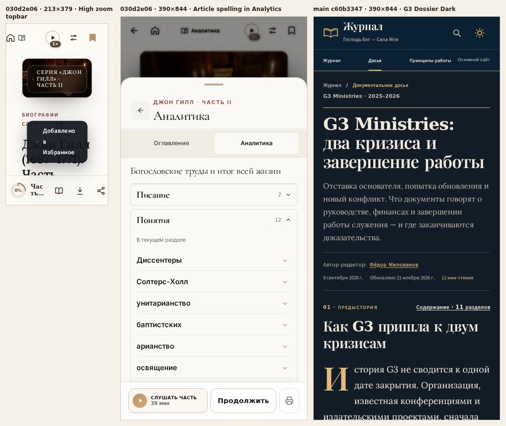

# Независимый аудит PR #2352 (`030d2e06`) и `main` (`c60b3347`) — раунд 21

Проверено на чистой пересборке `030d2e06` (`/tmp/head-030d-build`, `BUILD_030D_EXIT=0`) и `main` `c60b3347` (`/tmp/main-c60b-build`) без правки продуктового кода.

## 1. Верификация PR #2352 (`79ad7c94..030d2e06`)
- **`23e7de8c` доступность Настроек и Избранного при зуме 150–200% (`213×379`, `240×426`, контроль `320×568`):**
  - На `<270px` (`213px`, `240px`): `.mobile-top-bar` получает `overflow-x: auto` (`scrollW: 276`, `docOv: 0`), прокрутка и тап по `#mobSettingsBtn` (`setOpened: true`) и `.mobile-top-save` (`savePressed: "true"`) срабатывают штатно. (Побочная мелочь на экстремальных `213px`: подпись в нижней панели переносится по слогам `Час / ть…`.)
  - На `320×568`: медиа-запрос инертен (`overflowX: visible`, `scrollW: 320`), штатная панель не затронута.
- **`32461d4a` / `030d2e06` сохранение словоформ глоссария в «Аналитике» (`390×844`):**
  - На `/articles/dzhon-gill-chast-1-chelovek/` и `/articles/dzhon-gill-chast-2-uchenyi/` заголовки `.gbr-marginalia-term summary` берут видимый текст из статьи (`Particular Baptist`, `баптистских`, `гебраистов`, `Диссентеры`, `Солтерс-Холл`, `унитарианство`, `арианство`, `Таргумы`) вместо лемматизированного `data-term-title`.
- **Регрессия `W106` (`gill-panel-resize-state-repro.mjs`):** `REPRO_EXIT=0` ([лог](r21-resize-repro.jsonl)).

## 2. Тёмная тема и вложенные элементы `main` (`c60b3347`, `390×844`)
- **`/journal/dossiers/g3/`, `/articles/`, обновлённые Части I–II «Подростка за кадром»:** все проверенные маршруты в Dark mode (`data-reader-theme="dark"`, `bodyBg: rgb(14, 17, 22)`, `h1Color: rgb(242, 234, 221)`) имеют `docOv: 0`, `tableOv: 0`, битых `` нет.

[Замеры раунда 21](r21-checks.jsonl)
