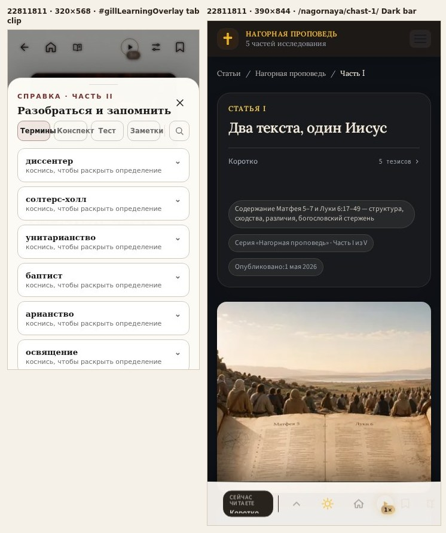

# Сводная проверка на баги текущей сборки (`PR #2352` `22811811` и `main` `c60b3347`) — раунд 22

Проверено на свежих пересборках `/tmp/head-2281-build` (`22811811`, `BUILD_2281_EXIT=0`) и `/tmp/main-c60b-build` (`c60b3347`) без правки продуктового кода.

## Что чисто (подтверждено на текущей сборке)
1. **Битые ссылки, якоря и ассеты (117 HTML-страниц):** `brokenLinksCount: 0`, `brokenAnchorsCount: 0`, `brokenAssetsCount: 0` (и в `22811811`, и в `main c60b3347`).
2. **Фикс `787abd10` (зум 200%, `213×379`):** `[data-gill-v16] .mobile-top-bar` имеет `touch-action: pan-x pan-y`, `overflow-x: auto`, вертикальный и горизонтальный свайпы работают.
3. **Регрессия `W106` (`gill-panel-resize-state-repro.mjs`):** `REPRO_EXIT=0` ([лог](r22-resize-repro.jsonl)).
4. **`/app/` (`320×568`):** прежний перелив `docOv: 7` устранён (`appOv: 0`).
5. **Возврат фокуса по `Escape` и прыжок из «Аналитики»:** `Escape` возвращает фокус на `#mobPartTocBtn` / `#mobSettingsBtn`; кнопка «К упоминанию в статье» закрывает `#partTocOverlay` и прокручивает статью.

## Подтверждённые открытые баги текущей сборки (`22811811`)
1. **`#gillLearningOverlay` на `320×568` — обрезка и наезд вкладок (`r22-findings.jpg`):**
   - Кнопки вкладок сжаты до `55px` (`clientW: 53`): `Термины` (`scrollW: 64`, −11px), `Конспект` (`scrollW: 66`, −13px → «Конспек»), `Заметки` (`scrollW: 60`, −7px). Текст упирается в границы пилюль и наезжает друг на друга.
2. **`/nagornaya/chast-1/` — Dark mode, Sepia и метаданные (`r22-findings.jpg`):**
   - В Dark mode нижняя плавающая панель остаётся со светлой подложкой `#f8f5ef`, иконки справа (`🔖`, `📖`) становятся светлыми на светлом и почти невидимыми, а пилюля `СЕЙЧАС ЧИТАЕТЕ / Коротко` подрезана снизу.
   - В Sepia страница остаётся в светлой палитре (`rgb(250, 248, 244)`).
   - В карточке метаданных отсутствует пробел: `Опубликовано:1 мая 2026`.
3. **`/izbrannoe/` (`320×568`):**
   - Верхняя шапка (`hdrBottom: 58`) переносит 4 кнопки (`btnsOut: 4`) на вторую строку, разрезая их нижней границей хедера; у сохранённой карточки «Код да Винчи» пустая градиентная заглушка вместо обложки.
4. **`#mobileSpeedrail` (`320×568`):**
   - Видимая ширина рельсы на `320px` — `88px` при `scrollW: 274px`, крайние чипы скоростей обрезаются по бокам.
5. **Символ `⏱` (`U+23F1`) на 54 страницах `/articles/*`:**
   - В Linux Chromium без системного emoji-шрифта отображается как пустой квадрат `▯` (`⏱ 26 мин`).
6. **`/map/` (`320×568`):**
   - Перепутаны ссылки на III и IV части Джона Гилла (`Часть III: Экзегет` ведёт на `chast-4`, `Часть IV: Наследие` — на `chast-3`).
7. **Мелкие дефекты:** `#partTocOverlay` в ландшафте `568×320` оставляет прокручиваемой области ~`30px`; в Search modal 4-й таб `АВТОРЫ` на `320px` обрезается до `АВТОР`; на `/konfessii/russkij-baptizm/` (`320px`) ссылка возврата обрывается на `Конфессии и Деноми`; на `/articles/kod-da-vinchi/` в Sepia контраст абзаца `4.4:1` (чуть ниже `4.5:1`).

[Замеры раунда 22](r22-checks.jsonl)
