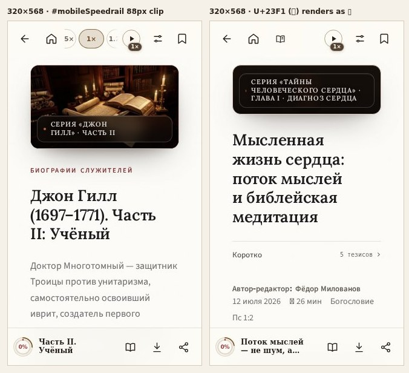

# Независимый аудит PR #2352 на коммите `6e80075b` (раунд 16)

Проверено на чистой пересборке `6e80075b70ce808c1e4e1f5978504cce4e120a0e` (`/tmp/head-6e80-build`) без модификации продуктового кода репозитория.

## 1. Проверка исправления `6e80075b` (`fix(gill): restore TOC Listen on frontmatter pages`)

- **`/articles/dzhon-gill-istoricheskiy-kontekst/` и `/articles/dzhon-gill-spravochnik/` (`320×568`, `390×844`, `1024×768`):** в футере `#partTocOverlay .gbat-foot` присутствуют все 3 действия: `[data-gbat-listen]` (**«Слушать статью»** + время чтения), `[data-gbat-continue]` («Продолжить») и `.gbat-fbtn--pdf` (печать/PDF).
  - На `320×568`: `136×52` (`Слушать статью` в 2 строки, `listenOverflow: 0`) + `100×52` + `40×52`, `docOv: 0`.
  - На `390×844`: `166×52` (`СЛУШАТЬ СТАТЬЮ` в 1 строку, `listenOverflow: 0`) + `138×52` + `40×52`, `docOv: 0`.
  - На `1024×768`: `207×52` + `173×52` + `42×52`.
- **Действие `[data-gbat-listen]` (`390×844`):** нажатие на `/articles/dzhon-gill-istoricheskiy-kontekst/` закрывает `#partTocOverlay` (`tocOpen: false`) и вызывает `window.speechSynthesis.speak` с первым абзацем статьи (идентично главам серии вроде `/articles/dzhon-gill-chast-2-uchenyi/`).
- **Регрессия `W106` (`gill-panel-resize-state-repro.mjs`):** `REPRO_EXIT=0` ([лог](r16-resize-repro.jsonl)).

## 2. Непроверенные разделы: `/baptisty-rossii/*`, оставшиеся `/karty/*` и `/hard-texts/*` (54 прогона на `320×568` и `1440×900`)

- **Все 10 подстраниц `/baptisty-rossii/*`**, **9 оставшихся `/karty/*`** и **все 8 `/hard-texts/*`**: **0 JS-ошибок (`pageerror`), 0 битых ``, `docOv: 0`, `tableOv: 0`**.
- **Мелкая находка на `/hard-texts/kniga-enoha-kotoroy-ne-bylo-kak-raznye-proizvedeniya-stali-korpusom/` (`320×568`):** в узкой ячейке таблицы слово `приложение` и диапазон `4Q208–4Q211` переносятся внутри ячейки без горизонтального переполнения.

[Сводка проверок](r16-checks.jsonl)

## Раунд 17: закрытие 100% маршрутов (21 оставшаяся статья `/articles/*`) и мобильные интерактивы (`6e80075b`)

- **Оставшиеся 21 статья `/articles/*` (`serdce-*`, `podrostok-za-kadrom-*`, `sovest-vnutrenniy-sud` и др.) на `320×568` и `1440×900` (42 прогона):** **0 JS-ошибок (`pageerror`), 0 битых ``, `docOv: 0`, `tableOv: 0`**; таким образом покрыты все 117 HTML-маршрутов сборки. Единственный перенос длинного слова в узкой таблице на `320×568` — `Движение` на `/articles/myslennaya-zhizn-serdca/`.
- **Символ `⏱` (`U+23F1`) в метаданных статей:** в строке `12 июля 2026 · ⏱ 26 мин` на `/articles/myslennaya-zhizn-serdca/` (и других статьях с тем же шаблоном) `U+23F1` в Linux Chromium отображается как пустой квадрат `▯` из-за отсутствия глифа в основном шрифте.
- **Мобильная панель скорости `#mobileSpeedrail` (`320×568`, `390×844`):** на `320×568` видимая ширина полосы — `88px` при `scrollW: 274px` (на `390×844` — `158px`), поэтому крайние кнопки обрезаны по краям; при этом выбор `1.5×` корректно обновляет бейдж и сохраняется после перезагрузки.
- **Глоссарий `.gterm` и CTA «Продолжить» на `/articles/dzhon-gill-chast-2-uchenyi/`:** попап `#gb-tip-1` открывается внутри вьюпорта с затемняющим фоном; кнопка `[data-gbat-continue]` закрывает `#partTocOverlay` и возвращает в область чтения.
- **Контроль `/nagornaya/chast-1/` (`320×568`, `768×1024`):** `docOv: 0`, локальный горизонтальный скролл `.ng-observation-matrix__scroll` — `482px` (`320px`) и `34px` (`768px`).

[Замеры раунда 17](r17-checks.jsonl)
