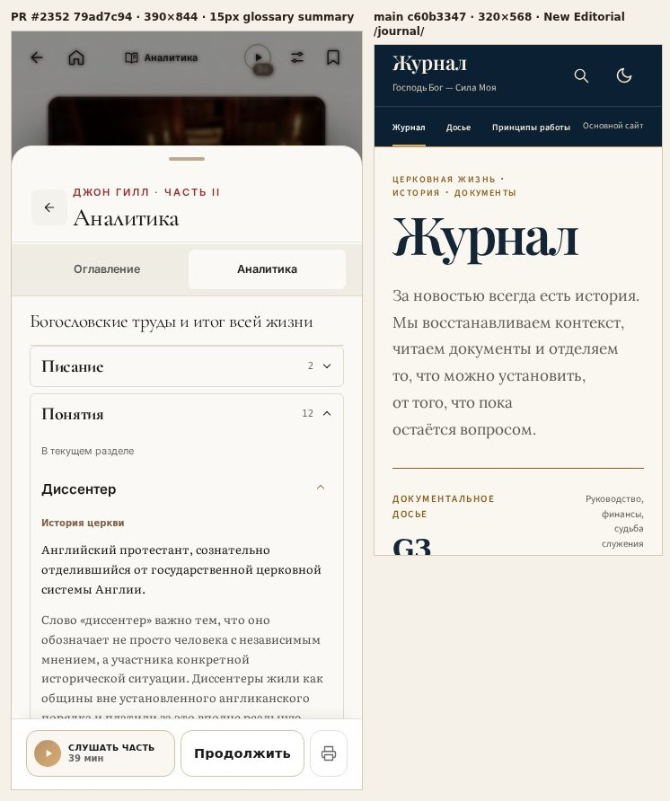

# Независимый аудит PR #2352 (`79ad7c94`) и нового `main` (`c60b3347`) — раунд 20

Проверено на чистых сборках без правки продуктового кода:
- PR #2352 `79ad7c94` (включает `56160c15` `W112` + `79ad7c94`): `/tmp/head-79ad-build`, `PR2352_BUILD_EXIT=0`
- `origin/main` `c60b3347` (включает `#2338`, `#2353`, `#2354`, `#2358`, `#2361`, `#2362`): `/tmp/main-c60b-build`, `MAIN_BUILD_EXIT=0`

## 1. Проверка PR #2352 (`56160c15` `W112` + `79ad7c94`)
- **`W112` повторное открытие скоростей по тапу на rate echo (`390×844`):** после выбора `1.25×` (и затем `1.5×`) тап точно в область нарисованного чипа `.reader-mobile-speed-chip` (`257..292, 35..50`) повторно раскрывает `#mobileSpeedrail` (`aria-expanded="true"`), **не** запуская озвучку (`speaks: 0`); тап в верхнюю область кнопки Play запускает озвучку (`speaks: 1`).
- **`W112` сброс выделения при открытии `.gterm` (`390×844`):** выделение абзаца вокруг `abbr.gterm[data-term="солтерс-холл"]` (`693` символа) сбрасывается до `0` при клике по термину, тултип открывается чисто (`tipOpen: true`).
- **`79ad7c94` читаемость заголовков глоссария в «Аналитике» (`320×568` и `390×844`):** `#partTocOverlay .gbr-marginalia-term summary` имеет `fontSize: 15px` (`lineHeight: 21.75px`), раскрывается корректно.
- **Регрессия `W106` (`gill-panel-resize-state-repro.mjs`):** `REPRO_EXIT=0` ([лог](r20-resize-repro.jsonl)).

## 2. Аудит нового `main` (`c60b3347`) на `320×568`, `390×844`, `768×1024`, `1440×900`
- Проверены обновлённые разделы и статьи: `/journal/`, `/journal/dossiers/g3/`, `/articles/`, `/articles/podrostok-za-kadrom-dvoynaya-zhizn/`, `/articles/podrostok-za-kadrom-roditelyam-posle-razoblacheniya/` (20 прогонов).
- **Итог:** **0 JS-ошибок (`pageerror`), 0 битых ``, `docOv: 0`, `tableOv: 0`, `hdrBtnsOut: 0`** на всех четырёх разрешениях; переключатель темы (`.je-masthead__button--theme` / `.ae-masthead__button--theme`) корректно переключает Light ↔ Dark (`bodyBg: rgb(253, 252, 249) ↔ rgb(14, 17, 22)`).

[Замеры раунда 20](r20-checks.jsonl)
