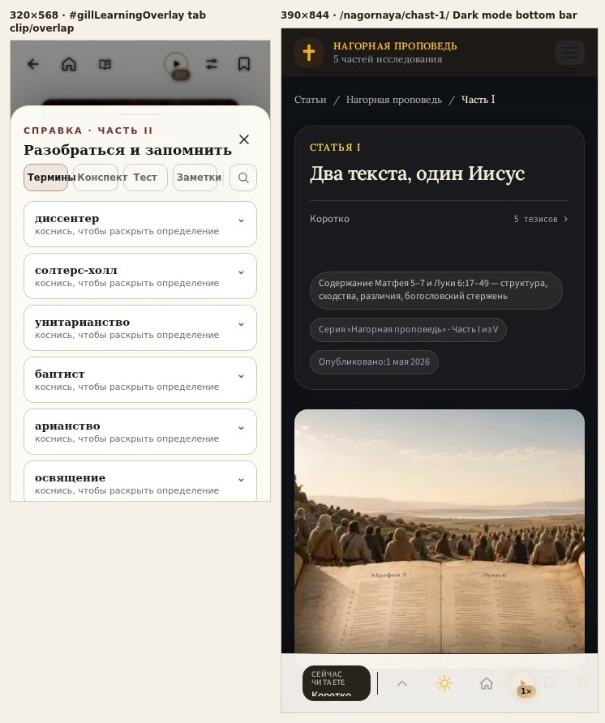

# Независимый аудит PR #2352 на коммите `7e2280ed` (раунд 18)

Проверено на чистой пересборке `7e2280ede63828f887fe649071e9df3d5b2907dc` (`/tmp/head-7e22-build`, `strangler:build` `BUILD_EXIT=0`) без правки продуктового кода.

## 1. Изменение `7e2280ed` и регрессия `W106`
- Коммит `7e2280ed` (`test(gill): align frontmatter listen contract`) обновляет только `scripts/reader-structured-content-browser-contract.mjs` (без изменений в `src/` и `public/`).
- Регрессия `W106` (`gill-panel-resize-state-repro.mjs`): `REPRO_EXIT=0` ([лог](r18-resize-repro.jsonl)).

## 2. Сквозной сценарий «Избранное» (`/izbrannoe/`) и шапка на `320×568`
- **Сохранение и удаление работают:** добавление через `.mobile-top-save` / `.gb-save` из трёх разных шаблонов (`/articles/dzhon-gill-chast-2-uchenyi/`, `/baptisty-rossii/vsehib-1944/`, `/articles/kod-da-vinchi/`) отображает `3 статьи` в `/izbrannoe/`, удаление кнопкой «Убрать из избранного» срабатывает, `#themeToggle` корректно переключает `html.dark` и `data-reader-theme="dark"`.
- **Проблемы вёрстки и медиа на `/izbrannoe/` (`320×568`):**
  1. Верхняя шапка (`hdrBottom: 58`) переносит 4 кнопки (`📱`, `🔖`, `🔍`, `🌙`) на вторую строку (`top: 46, bottom: 90`), разрезая их линией нижней границы шапки.
  2. Карточка «Код да Винчи» отрисовывается с пустой градиентной заглушкой вместо обложки (`imgs: []`), а у карточки «Баптисты России» отсутствует и превью, и рубрика над заголовком.

## 3. Сброс настроек чтения (`#gillSettingsReset`), поиск (`#gbCommandPalette`) и глоссарий на других шаблонах
- **`#gillSettingsReset` на `/articles/dzhon-gill-chast-2-uchenyi/` (`320×568`):** в текущей сборке сброс темы `dark → light` срабатывает **мгновенно без перезагрузки** (`liveAfterReset.theme === "light"`, сохраняется после reload).
- **Поиск `#gbCommandPalette` (`320×568`):** запрос `"Гилл"` даёт `7 рез.` по локальному индексу даже без Pagefind; пустой запрос `"абырвалг123"` показывает `0 рез. Ничего не найдено` с подсказками популярных запросов.
- **Тултипы глоссария вне серии Гилла (`390×844`):** на `/baptisty-rossii/vsehib-1944/`, `/articles/20-antisovetov-pastoru/` и `/nagornaya/chast-1/` всплывающие подсказки терминов открываются внутри границ вьюпорта.

[Сводка замеров](r18-checks.jsonl)

## Раунд 19: максимальный масштаб текста (`320×568`), режим «Обучение», аудит Dark/Sepia по 5 шаблонам и интерактивы справочников (`7e2280ed`)

- **`#gillLearningOverlay` (`320×568` на `/articles/dzhon-gill-chast-2-uchenyi/`):** все 4 вкладки (`Термины`, `Конспект`, `Тест`, `Заметки`) переключаются без JS-ошибок и горизонтального скролла (`ov: 0`), **однако** на `320px` пилюли табов в шапке наезжают/режут текст (`Термины` упирается в `Конспект`, `Конспект` обрезается до `Конспек`, `Заметки` вплотную к краю).
- **Максимальный `A+` (`320×568`, Gill II):** `docOv: 0, tableOv: 0`.
- **Темы Dark и Sepia по 5 шаблонам (`390×844` — `/`, Gill II, `vsehib-1944`, `nagornaya/chast-1`, `kod-da-vinchi`):**
  1. **`/nagornaya/chast-1/` (Dark):** нижняя панель навигации остаётся светлой (`#f8f5ef`) поверх тёмного фона, из-за чего светлые иконки справа (`🔖`, `📖`) сливаются с белой подложкой, а блок `СЕЙЧАС ЧИТАЕТЕ / Коротко` обрезается снизу; сохраняется `Опубликовано:1 мая 2026` без пробела.
  2. **`/nagornaya/chast-1/` (Sepia):** `bodyBg: rgb(250, 248, 244)` — шаблон Нагорной проповеди не переключается в палитру Сепии.
  3. **`/articles/kod-da-vinchi/` (Sepia):** текст `p` (`rgb(118, 101, 77)` на `rgb(238, 227, 200)`) имеет контраст `4.4:1` (чуть ниже порога `4.5:1`).
  4. **`/`, Gill II, `/baptisty-rossii/vsehib-1944/`:** Dark и Sepia проходят с контрастом ≥ `4.5:1` и `docOv: 0`.
- **Справочники и источники (`/articles/dzhon-gill-spravochnik/`, `/baptisty-rossii/spravochnik/`, `/nagornaya/istochniki/`, `/nagornaya/nakhodki/`, `390×844`):** `docOv: 0`, аккордеоны раскрываются (`aria-expanded="true"`).

[Замеры раунда 19](r19-checks.jsonl)
