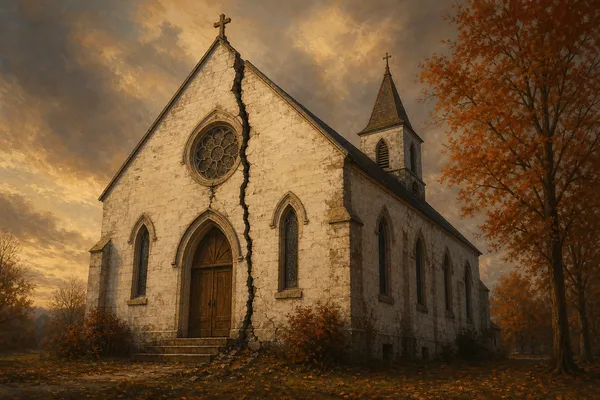

## Тёмная сторона кафедры

Часть II канонического ядра. [Первая часть серии](/articles/20-antisovetov-pastoru/) показала множество отдельных пастырских ошибок и самооправданий. Эта часть спрашивает о внутренней динамике крушения: **как отдельная слабость лидера и отдельная уступка среды постепенно становятся устойчивым способом жить?**

<figure class="article-figure">

<figcaption>Белая церковь с глубокой трещиной по фасаду — символ внутреннего разложения системы</figcaption>
</figure>
<section class="summary-card" aria-labelledby="kortko" data-speakable>
<h2 id="kortko">Коротко</h2>
<ol class="summary-card__body" role="list">
<li class="summary-card__item">
Не всякий тяжёлый грех пастора доказывает наличие «системы». Системное разложение начинается там, где личный грех получает организационную защиту, повторяемость и цену для тех, кто пытается его исправить.
</li>
<li class="summary-card__item">
Пять стадий — не пророческая шкала и не диагноз по одному признаку. Это исследовательская матрица, собранная из сопоставления нескольких десятков публично документированных церковных кризисов: <strong>идол платформы → демонтаж подотчётности → страх и контроль → защита репутации → косметическое покаяние / реформа / распад</strong>.
</li>
<li class="summary-card__item">
Стадии могут останавливаться, идти не строго по порядку и частично накладываться. Ценность модели — не в предсказании будущего, а в том, чтобы раньше увидеть изменение направления.
</li>
<li class="summary-card__item">
Психологические и управленческие термины здесь вторичны. Главные нравственные категории Писания — гордость, страх человеческий, лицеприятие, ложь, господство, корысть, сокрытие греха и отказ от покаяния.
</li>
<li class="summary-card__item">
На каждой стадии главный диагностический вопрос один: <strong>способна ли истина исправить центр власти — или центр власти уже научился исправлять саму версию истины?</strong>
</li>
</ol>
</section>

<h2 id="metod">Что эта модель утверждает — и чего не утверждает</h2>

Предлагаемая ниже карта выросла из сопоставления нескольких десятков публично документированных церковных кризисов последних десятилетий (включая независимые обзоры *Thirtyone:eight*, расследования в Церкви Англии, отчёт *Guidepost Solutions* и материалы Австралийской королевской комиссии) с классическим пастырским богословием духовной власти. Когда читаешь эти документы подряд, поражает не пестрота конфессиональных вывесок, а упрямая повторяемость одних и тех же нравственных поворотов. Однако любую повторяющуюся траекторию важно сразу оградить от ложного употребления: исследовательская карта описывает типичную причинную связку в изученных крушениях, но её нельзя превращать в механический закон природы или в быстрый опросник для вынесения приговоров по одному внешнему совпадению (библейские цитаты здесь и далее приводятся по русскому Синодальному переводу).

Прежде всего, эта модель **не утверждает**, будто всякая численно большая община неизбежно перерождается или будто широкая известность проповедника сама по себе равна идолопоклонству. Она не учит и тому, что любой острый спор между братским советом и ведущим пастором автоматически доказывает авторитаризм. Точно так же обращение к юристам, бережная конфиденциальность душепопечения или взвешенная публичная речь в дни кризиса ещё не означают заговора молчания, равно как и не каждый оступившийся служитель проходит все пять ступеней в одном и том же порядке.

Модель утверждает куда более скромную, но проверяемую пастырскую истину. Там, где сохранение площадки служения становится высшим мерилом добра, а независимая братская проверка превращается в декорацию, община теряет внутренние тормоза. Когда честный вопрос обходится вопрошающему слишком дорого, забота о добром имени организации бежит впереди правды, а покаяние сводится к управлению впечатлением публики, **личный грех человека получает системную броню**. Знание этих ступеней нужно не для охоты на ведьм, а для раннего трезвения, пока поворот руля ещё не требует обрушения целых судеб.

<h2 id="lichnoe-sistemnoe">Личный грех и системное зло — не одно</h2>

Всякое серьёзное пастырское различение начинается с водораздела между личным прегрешением служителя и болезненным устройством самой среды. Живой пастор остаётся грешным человеком, нуждающимся в ежедневной благодати: он может сорваться на резкость от переутомления, ошибиться в оценке людей, поддаться минутному тщеславию или даже впасть в тяжкий личный грех, как это случалось с известными проповедниками (ср. [разбор самообмана и двойной жизни в кейсе Стивена Лоусона](/articles/steven-lawson-samoobman-i-publichnyy-golos/)). Любой такой поступок трагичен перед Богом, однако сам факт падения одного человека ещё не доказывает, что вся церковь жила по законам духовного насилия.

Системное зло рождается на следующем шаге — там, где вокруг греха выстраивается защитный контур, оберегающий центр власти от света и делающий неправду самоподдерживающейся. Помощники и прихожане постепенно приучаются обходить опасную тему молчанием, а братский совет получает тщательно отфильтрованную картину событий. Попытка задать прямой вопрос по Писанию оборачивается охлаждением или отстранением; один и тот же проступок мягко покрывается у «своих» и сурово карается у неудобных людей. В итоге публичные объяснения сглаживают очевидную вину, а после громких слов о сожалении все прежние рычаги бесконтрольной власти остаются в тех же руках.

Именно поэтому в разговоре о церковных крушениях недостаточно спрашивать только: «В чём согрешил сам лидер?» Не менее важный диагностический вопрос звучит иначе: **«Что сделала церковная среда в тот день, когда впервые узнала неудобную правду?»** Ответ на этот второй вопрос безошибочно отделяет раненую, но живую общину от замкнутой системы самосохранения.

<h2 id="stadiya-1">Стадия 1. Служение становится платформой, которую нельзя потерять</h2>

Первая ступень редко выглядит как явное беззаконие; напротив, она почти всегда вырастает на почве видимого благословения и искреннего труда. Полные залы, тысячи слушателей проповедей, издательские и миссионерские начинания, благодарные письма обращённых — ни один из этих плодов сам по себе не является грехом. Надлом происходит в глубине сердца тогда, когда площадка служения, накопленные достижения и узнаваемое имя перестают быть скромным орудием в руках Господа и превращаются в собственность, утрата которой переживается служителем как крушение самой личности (ср. [исследование о скрытых идолах сердца](/articles/skrytye-idoly-serdca/)).

Священное Писание ставит против этого соблазна двойной заслон. Апостол Пётр умоляет старейшин как «сопастырь»: «Пасите Божие стадо, какое у вас, надзирая за ним не принужденно, но охотно и богоугодно, не для гнусной корысти, но из усердия, и не господствуя над наследием Божиим, но подавая пример стаду; и когда явится Пастыреначальник, вы получите неувядающий венец славы» (1 Пет. 5:2–4). Стадо принадлежит Богу, а не проповеднику; земной пастырь лишь временно бережёт чужое достояние до прихода настоящего Хозяина. Ещё короче эту меру выразил Иоанн Креститель, когда ученики встревожились уходом слушателей ко Христу: «Ему должно расти, а мне умаляться» (Ин. 3:30). Эти слова не осуждают плодовитый труд, но они на корню разрушают иллюзию, будто Божье Царство рухнет, если конкретный человек сойдёт со сцены.

### Стадия 1 · Механизм и ранние маркеры

Когда площадка сливается с личной идентичностью лидера, в сознании команды незаметно меняются нравственные весы. Рождаются опасные негласные допущения: «если пострадает его доброе имя, пострадает само дело Евангелия в нашем городе»; «человека такого дарования нужно оберегать от обычных вопросов, потому что через него каются сотни людей»; «открытое несогласие с ним смутит слабых и остановит рост». Полезность человека начинает теснить Божий закон: то, что вчера назвали бы гордостью, резкостью или нечистоплотностью, сегодня оправдывают «колоссальной нагрузкой миссии».

Распознать этот сдвиг можно задолго до открытых срывов. Имя одного проповедника становится фактическим синонимом всей поместной церкви; здоровье общины измеряется цифрами охвата, сборов и новых начинаний, тогда как тихая верность в собственной семье, кротость нрава и доступность для простых овец списываются как неизбежные издержки «большого призвания». Самый точный ранний признак первой стадии проявляется в том, как люди отвечают на простой мысленный вопрос: «Что станет с нашей церковью, если завтра ведущий пастор не сможет выйти за кафедру?» Там, где этот вопрос вызывает почти панический ужас, платформа уже заняла место, принадлежащее одному Христу. Здоровый же служитель сознательно строит общину, способную твёрдо стоять без него: выращивает других проповедников, открывает коллегам всю полноту сведений и радуется, когда прихожане привязываются к Слову Божьему сильнее, чем к его голосу.

<h2 id="stadiya-2">Стадия 2. Подотчётность становится декоративной</h2>

Если первая стадия ещё может оставаться внутренней борьбой одного сердца, то вторая ступень переводит личную уязвимость в системное заболевание. Новый Завет последовательно показывает множественность пресвитеров в поместных общинах (Деян. 14:23; 20:17, 28; Флп. 1:1; Тит. 1:5; 1 Пет. 5:1), а книга Притчей напоминает: «При недостатке попечения падает народ, а при многих советниках благоденствует» (Притч. 11:14). Однако само по себе наличие пяти или семи фамилий в пресвитерском совете ещё не создаёт живой подотчётности: устав на бумаге может выглядеть образцово в тот самый час, когда реальная возможность поправить первого служителя уже полностью демонтирована.

### Стадия 2 · Механизм и точка невозврата

Декоративная подотчётность складывается тогда, когда ведущий лидер сам отбирает тех, кто призван его проверять, и дозирует поступающие к совету сведения. В его же руках сосредоточиваются ключевые рычаги влияния — штатные ставки, оклады, доступ к кафедре или репутация внутри братства. В такой обстановке любое содержательное возражение за братским столом быстро переводится из плоскости поиска истины в вопрос «лояльности общему видению», а для самого руководителя закрепляются негласные исключения из общих финансовых, кадровых и бытовых правил.

Именно поэтому демонтаж подотчётности оказывается опаснее самой первой уступки гордости. Пока рядом с пастырем стоят равные и независимые братья, способные в духе апостола Павла («не потому, будто мы берем власть над верою вашею; но мы споспешествуем радости вашей: ибо верою вы тверды» — 2 Кор. 1:24) остановить его у опасной черты, ошибку ещё можно заметить и исцелить без крушения. Но когда обратная связь превращена в бутафорию, церковный организм лишается зрения и боли: дальше все последующие стадии зреют в темноте, оставаясь невидимыми изнутри вплоть до публичного обвала. Проверить, жива ли коллегиальность на деле, помогает один прямой вопрос: **может ли член совета, всерьёз не согласившийся с ведущим пастором по принципиальному вопросу, сохранить своё служение, полный доступ к документам и право довести проверку до честного конца?** Если история общины раз за разом отвечает на этот вопрос «нет» — перед нами фасадная витрина, а не библейское сопастырство.

<h2 id="stadiya-3">Стадия 3. Цена вопроса становится выше самого вопроса</h2>

Когда независимые голоса в руководстве ослаблены, порядок в общине начинает удерживаться не столько убедительностью Писания, сколько негласным тарифом на несогласие. На третьей стадии задать неудобный вопрос становится дороже, чем промолчать. Сам вопрос при этом остаётся без предметного ответа, зато фигура вопрошающего немедленно попадает под пристальный разбор.

### Стадия 3 · Механизм и строгая библейская рамка

В повседневной жизни церкви это выглядит буднично и тихо. Человека, вежливо попросившего пояснить крупную статью расходов или сомнительное управленческое решение, без объяснений отодвигают от служения ещё до всякого разбирательства; вчерашнее сердечное тепло со стороны старших сменяется ледяной дистанцией; спокойное расхождение во мнениях приписывают «духовной незрелости», «горечи» или «скрытому бунту» (о том, как для этого выворачивают наизнанку библейские стихи, подробно говорится в [Части III](/articles/teksty-pisaniya-kotorymi-manipuliruyut/)); а личные признания, некогда доверенные пастырю на исповеди или в душепопечительской беседе, внезапно всплывают как аргумент против надёжности самого свидетеля. Окружающие считывают урок мгновенно: безопаснее не вникать и не спрашивать.

При богословской оценке этой атмосферы важно соблюдать экзегетическую точность и не навязывать библейским стихам чуждый им предмет. Нередко здесь по инерции цитируют 1 Ин. 4:18 («В любви нет страха, но совершенная любовь изгоняет страх, потому что в страхе есть мучение») или 2 Кор. 3:17 («Господь есть Дух; а где Дух Господень, там свобода») как прямые регламенты церковного управления. В действительности апостол Иоанн говорит об уверенности искупленного чада Божьего перед днём последнего суда, а Павел — о снятии ветхозаветного покрывала с сердца во Христе; поэтому оба текста звучат здесь лишь как законный канонический отзвук — напоминание о том, что подлинная евангельская любовь и удушающий страх принадлежат к разным духовным мирам. Прямой же библейский суд над запугиванием в общине вершат иные тексты: Христово запрещение властвовать над братьями по образцу земных вельмож («вы знаете, что князья народов господствуют над ними, и вельможи властвуют ими; но между вами да не будет так» — Мф. 20:25–26), апостольский запрет господствовать над уделом Божьим (1 Пет. 5:2–3; 2 Кор. 1:24) и древняя премудрость Соломона: «Боязнь пред людьми ставит сеть; а надеющийся на Господа будет безопасен» (Притч. 29:25; ср. [разбор рабского и сыновнего страха](/articles/strah-bozhij-rabskij-ili-synovnij/)).

Ранний признак третьей стадии улавливается в том, о чём верующие думают перед разговором со служителем: они взвешивают уже не «верен ли мой вопрос по Слову?», а «во что обойдётся моей семье, если я открою рот?». Разумеется, одиночная робость может корениться и в прошлом опыте самого прихожанина; но когда один и тот же сковывающий страх независимо друг от друга описывают трезвые, прежде не сговаривавшиеся люди — особенно вслед за реальными случаями возмездия, — община обязана бить тревогу.

<h2 id="stadiya-4">Стадия 4. Репутация начинает управлять правдой</h2>

К четвёртой ступени внутреннее смещение ценностей заходит так далеко, что руководство уже с полной субъективной искренностью отождествляет неприкосновенность фасада с защитой славы Божьей. Евангелист Иоанн называет духовный корень этой слепоты без современных управленческих иносказаний: «Ибо возлюбили больше славу человеческую, нежели славу Божию» (Ин. 12:43), и приводит приговор Самого Спасителя: «Всякий, делающий злое, ненавидит свет и не идет к свету, чтобы не обличились дела его, потому что они злы, а поступающий по правде идет к свету, дабы явны были дела его, потому что они в Боге соделаны» (Ин. 3:20–21).

### Стадия 4 · Механизм и проверка на конфликт интересов

Суть четвёртой стадии обнажается в первые же часы после поступления тяжёлого сигнала о грехе или злоупотреблении. В здоровом доме Божьем первый вопрос всегда звучит по-пастырски: «Что произошло на самом деле и кто прямо сейчас нуждается в защите?» Там же, где правдой управляет репутация, первыми срываются с языка совсем другие вопросы: «Кто ещё об этом знает?», «Что начнётся в городе, если история выйдет наружу?», «Как это скажется на сборах и строительстве?», «Кому выгодно поднять эту тему именно сегодня?». Неудобное свидетельство подавляют уже не потому, что доказана его ложность, а потому, что сама правда угрожает образу безупречного служения; и вернейший ранний признак этой стадии состоит в том, что ещё **до начала проверки фактов** у руководства готов подробный порочащий рассказ о дурном характере и скрытых мотивах заявителя (ср. почерк Диотрефа в 3 Ин. 9–10 и [Досье A «Диотрефы нашего времени»](/articles/diotrefy-nashego-vremeni/)).

Именно здесь решается судьба любой церковной проверки. Не всякое внутреннее разбирательство непременно обманно и не всякая приглашённая со стороны комиссия автоматически беспристрастна: всё определяет реальное отсутствие конфликта интересов. Трезвый наблюдатель обязан спросить: кто именно назначает и оплачивает проверяющих? Открыт ли им прямой доступ к переписке, бухгалтерии и бывшим сотрудникам без предварительной цензуры? Не используются ли соглашения о неразглашении для того, чтобы купить молчание пострадавших? И главное — может ли итоговое заключение увидеть свет и быть передано общине (а при признаках преступления — законным властям) без хозяйской правки со стороны тех самых лиц, чьи действия проверялись?

<h2 id="stadiya-5">Стадия 5. Покаяние становится управлением ущербом — или начинается реформа</h2>

Пятая стадия наступает тогда, когда скрывать нарыв больше невозможно и кризис прорывается наружу. Важно помнить, что даже в этой поздней точке исход не предрешён фатально. Община оказывается на последнем распутье, где она либо окончательно выбирает плотское самосохранение под маской благочестивых фраз, либо впервые сокрушается всерьёз и начинает трудное очищение.

Писание даёт для различения этих двух путей два острейших мерила. Первое — слова пророка Иеремии о вождях, которые «врачуют раны народа Моего легкомысленно, говоря: "мир! мир!", а мира нет» (Иер. 6:14). Второе — апостольское разграничение двух видов слёз во Втором послании к Коринфянам: «Ибо печаль ради Бога производит неизменное покаяние ко спасению, а печаль мирская производит смерть» (2 Кор. 7:10). В следующих стихах Павел показывает, как выглядит подлинная печаль ради Бога на деле — какое она рождает усердие к правде, какую готовность очистить зло, какой святой страх перед Господом, а не перед потерей кресла (2 Кор. 7:11).

### Косметическое покаяние против подлинной реформы

Когда покаяние превращается в технологию сглаживания ущерба, оно узнаётся по устойчивому набору уловок. Конкретный библейский грех — ложь, властолюбие, рукоприкладство, корысть или разврат — переименовывают в обтекаемые житейские шероховатости: «неудачный стиль общения», «эмоциональное выгорание», «ошибки роста». Виновный признаёт ровно ту долю сведений, которую уже невозможно опровергнуть документами, и облекает извинение в условный оборот («простите, если мои слова кого-то задели»), перекладывая ответственность на «неправильное восприятие» слушателей. В одной и той же речи звучат слёзы смирения и тут же — тонкие намёки на злокозненность критиков; меняются формулировки пресс-релизов, но не меняются ни состав зависимого совета, ни уставные полномочия, позволившие беде длиться годами.

Подлинное церковное покаяние всегда предметно и дорого стоит центру власти. В нём грех назван своим библейским именем без скидок на прежние заслуги; публичная неправда публично же опровергнута; с пострадавших снимают лукавое требование «немедленно обняться и забыть ради единства»; люди с конфликтом интересов отходят от ведения дела, а независимая проверка получает все закрытые папки. Главное же — сам согрешивший пастор не ставит сохранение за собой кафедры предварительным условием своего раскаяния.

Ибо даже самое глубокое, искреннее покаяние перед Богом и полное братское прощение в общине не решают автоматически вопрос пригодности человека к пастырскому служению. Требования к епископу в 1 Тим. 3:1–7 и Тит. 1:5–9 («непорочен... имеющий доброе свидетельство от внешних») остаются в силе и после прощения греха. Зрелая церковь способна обнять кающегося брата Христовой милостью и вместе с тем твёрдо сказать, что тяжесть и последствия содеянного более не позволяют ему носить пастырский жезл (подробнее об этом различении см. в [Части V о церковной дисциплине](/articles/cerkovnaya-disciplina-vlast-granicy-zashchita/#proshchenie)).

<h2 id="tri-osi">Три оси, без которых пяти стадий недостаточно</h2>

Чтобы описанная пятиступенчатая матрица не выродилась в поверхностный ярлык, которым бросаются в каждом церковном споре, любой реальный случай необходимо взвешивать сразу по трём независимым осям: **тяжести**, **повторяемости** и **исправимости**. Ось **тяжести** напоминает, что не всякий промах стоит в одном нравственном ряду: неловкая оговорка уставшего проповедника, запутанная отчётность по стройке, многолетняя клевета на уходящих и уголовное преступление против ребёнка требуют совершенно разной скорости и строгости ответа (ср. Иез. 34:2–4; Рим. 13:3–4). Ось **повторяемости** отделяет единичный срыв от выстроенного режима: даже болезненный эпизод остаётся эпизодом, пока мы не проверили, воспроизводится ли тот же сценарий с разными людьми из года в год. Наконец, ось **исправимости** нередко говорит о духовном состоянии общины больше, чем сама первоначальная беда: там, где совет старейшин способен услышать упрёк, остановить руководителя, исправить процедуру и открыть окна для света, перед нами живая, кающаяся церковь Христова (ср. [Часть VIII «Признаки здоровой церкви»](/articles/priznaki-zdorovoy-cerkvi/)), тогда как ожесточённая круговая оборона выдаёт поражение самого иммунитета общины.

<h2 id="rannie-markery">Ранняя диагностика без охоты на ведьм</h2>

Вместо того чтобы гадать о чужих тайных намерениях или спешить с громким приговором «духовное насилие», гораздо честнее наблюдать за проверяемыми привычками церковного дома. Устойчивые очертания здоровой или больной среды проступают не в юбилейных речах, а в будничных мелочах управления и братского общения. Поэтому и пастырям, и членам церкви полезно спокойно проверить жизнь своей общины по десяти наблюдаемым вопросам:

1. Кто в вашей церкви реально способен сказать ведущему пастору твёрдое «нет», не рискуя при этом работой, служением или добрым именем?
2. Имеют ли другие пресвитеры и ревизоры прямой, не фильтруемый одним лицом доступ к первичной бухгалтерии, протоколам и обращениям?
3. Что на практике происходило за последние годы с людьми, которые вежливо и аргументированно не соглашались с курсом руководства?
4. Применяется ли одна и та же нравственная мерка к родственникам и друзьям лидера — и к тем, кто задаёт ему неудобные вопросы?
5. Способно ли руководство назвать собственный конкретный просчёт прямыми словами, без туманных оправданий и страдательного залога?
6. Существует ли понятный и безопасный путь подать жалобу на самого влиятельного человека в общине так, чтобы он не был судьёй в собственном деле?
7. Может ли семья мирно перейти в другую здравую евангельскую церковь, не превращаясь автоматически в «отступников» и «врагов» (см. [Часть VI](/articles/kogda-uhodit-kogda-ostavatsya/))?
8. Становится ли община с годами менее зависимой от одарённости одной центральной фигуры за счёт роста других учителей и старейшин (см. [Часть VII](/articles/vernye-i-neizvestnye-zdorovoe-pastyrstvo/))?
9. Когда поступает тревожный сигнал о возможном вреде слабому, кого инстинктивно бросаются защищать в первую минуту — возможную жертву и правду или доброе имя кафедры?
10. Если церковь уже проходила через острый кризис, изменились ли после него реальные правила принятия решений — или дело ограничилось трогательной речью?

Ни один отдельный ответ из этого списка сам по себе не заменяет всестороннего разбирательства. Отдельный перекос может объясняться временной незрелостью молодой церкви или простой нехваткой тружеников. Но честная совокупность этих ответов во времени позволяет заметить опасный крен корабля задолго до встречи с рифами.

<h2 id="dvustoronnee">Двустороннее зеркало</h2>

Христианская совесть обязывает повернуть это зеркало и в сторону церковной скамьи, потому что нечестное сердце прихожанина способно превратить любую диагностическую матрицу в орудие собственной гордыни (этому посвящён финальный предохранитель серии в [Части IX «Несовершенный человек в несовершенной церкви»](/articles/nesovershennyy-chelovek-v-nesovershennoy-cerkvi/)). При желании можно обозвать «идолом платформы» любое плодотворное и заметное служение или заклеймить «декоративным советом» зрелых пресвитеров лишь за то, что они после честного разбора не поддержали нашу личную жалобу. Точно так же легко выдать за «атмосферу страха» собственное нежелание слышать библейское обличение своего греха, назвать «защитой фасада» бережное хранение чужой исповеди, а «косметическим покаянием» — всякое искреннее извинение пастора, которое не закончилось желанной для критика отставкой.

Поэтому честное применение этой модели к конкретным людям требует от члена церкви ровно той же строгой дисциплины свидетельств, на которой построено документальное [Досье A](/articles/diotrefy-nashego-vremeni/): сначала проверенный факт, затем его место в библейской шкале тяжести, затем ясная граница вывода и опора на проверяемые источники, а не на пересказы из третьих уст (Притч. 18:14, 18). Там, где данных ещё недостаточно, зрелый христианин не бросается словами «у нас четвёртая стадия разложения», а говорит трезво и целомудренно: «есть тревожные признаки, которые нуждаются в спокойной братской проверке». Ибо ложное обвинение против верного пресвитера так же ненавистно Богу, как и укрывательство нечестивого.

<h2 id="zaklyuchenie">Падение начинается раньше скандала — и исправление тоже</h2>

Самая обнадёживающая весть этой анатомии состоит в том, что крушение вовсе не становится неизбежным после первого неверного шага. Газетные заголовки фиксируют лишь последний обвал стены, которую годами подтачивала скрытая влага. На первой, второй и даже третьей ступени поворот к свету всё ещё открыт и не требует руин.

На ранних подступах служитель и совет пресвитеров ещё могут добровольно слезть с пьедестала незаменимости, вернуть коллегам реальное право голоса и финансового контроля, поблагодарить брата за трудный вопрос вместо того, чтобы наказывать его холодностью, и назвать маленькую неправду маленькой неправдой — прежде чем для её прикрытия понадобится громоздить большую ложь. Система разлагается тогда, когда каждый новый компромисс становится неизбежной платой за укрытие предыдущего; а исцеление начинается в обратном порядке — с выхода к свету Христову (Ин. 3:21), где верность Пастыреначальнику бесконечно дороже сохранности любой человеческой площадки.

<section class="sources-block" data-reader-exclude data-pagefind-ignore>

<h2 id="istochniki">Исследовательская база</h2>

Описанная выше диагностическая матрица опирается на сопоставление независимых и официальных церковных расследований, где документированы проверяемые управленческие процессы — устройство подотчётности, конфликт интересов, фильтрация сведений, реакция на обращения пострадавших и глубина последующих реформ, — в свете библейского богословия пастырства (все цитаты Священного Писания приведены по русскому Синодальному переводу):

- **Священное Писание (Синодальный перевод):** Притч. 11:14; 18:14, 18 (в масоретской нумерации — 18:13, 17); 29:25; Иер. 6:14; Иез. 34:2–4; Мф. 20:25–28; Ин. 3:20–21, 30; 12:43; Деян. 14:23; 20:17, 28–30; 2 Кор. 1:24; 7:10–11; Флп. 1:1; 1 Тим. 3:1–7; Тит. 1:5–9; 1 Пет. 5:1–5; 3 Ин. 9–10 (тексты 1 Ин. 4:18 и 2 Кор. 3:17 привлекаются только с учётом их собственного заветного и эсхатологического контекста).
- **Thirtyone:eight** — [*Independent Learning Review: The Crowded House, Sheffield* (2020)](https://thirtyoneeight.org/safeguarding-services/consultancy/case-and-learning-reviews/crowded-house-redeemer-church-sharrow-vale-review/) и [*Independent Lessons Learned Review: Jonathan Fletcher and Emmanuel Church Wimbledon* (2021)](https://thirtyoneeight.org/safeguarding-services/consultancy/case-and-learning-reviews/jonathan-fletcher-review/). Независимые аналитические отчёты о культуре неформального доминирования, декоративной подотчётности и высокой цене несогласия внутри круга доверенных лиц.
- **Church of England National Safeguarding Team** — [*Concerns Substantiated in Mike Pilavachi Investigation* (2023)](https://www.churchofengland.org/news/concerns-substantiated-mike-pilavachi-investigation). Официальное сообщение по итогам расследования многолетнего злоупотребления духовным авторитетом и игнорирования ранних предупреждений.
- **Guidepost Solutions** — [*Report of the Independent Investigation of the Southern Baptist Convention Executive Committee* (2022)](https://guidepostsolutions.com/insights/media-mentions/guidepost-solutions-report-of-the-independent-investigation-of-the-southern-baptist-convention/). Документальное исследование того, как приоритет защиты репутации и опасение юридического ущерба вытесняют пастырскую заботу о пострадавших (стадия 4).
- **Royal Commission into Institutional Responses to Child Sexual Abuse (Australia)** — [*Case Study 18: Australian Christian Churches* (2014–2015)](https://www.childabuseroyalcommission.gov.au/case-studies/case-study-18-australian-christian-churches). Официальный корпус протоколов и выводов о конфликтах интересов при внутренних проверках и сокрытии правонарушений.
- **Diane Langberg** — [*Redeeming Power: Understanding Authority and Abuse in the Church* (Brazos Press, 2020)](https://www.dianelangberg.com/shop-books/) и **Michael J. Kruger** — [*Bully Pulpit: Confronting the Problem of Spiritual Abuse in the Church* (Zondervan, 2022)](https://www.amazon.com/dp/0310136385). Богословский синтез библейского учения о пастырской власти и механизмов самозащиты церковных систем.

</section>
